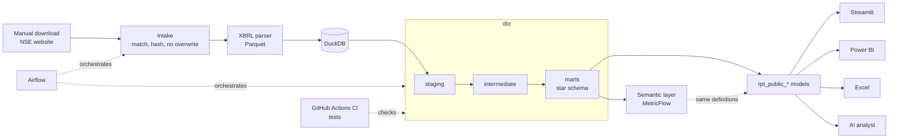

# ESG Lens India

Turns the BRSR sustainability filings (XBRL) of the NIFTY 50 companies plus Wipro, FY2022-23 to
FY2025-26, into a tested warehouse of comparable ESG metrics, with a semantic layer, SQL and
statistical analysis, Power BI and Excel models, a Streamlit report card and a guarded AI analyst.

[](https://github.com/pritysapkal/esg-lens-india/actions/workflows/ci.yml)


Live app: coming soon (Streamlit Community Cloud deployment pending) · Demo video: coming soon

> New here? [docs/START_HERE.md](docs/START_HERE.md) is the project on one page.
> This is not an ESG rating and not investment advice.

## Key findings

All figures are calculated values (shares, intensities, medians, p-values); no filed quantity is
shown. Details and caveats: [analysis_findings.md](docs/analysis_findings.md),
[stats_findings.md](docs/stats_findings.md).

1. **Five companies carry 85% of Scope 1+2 emissions** in the set: 85.5% to 86.2% in every year, and
   ten carry 98.5%. Any "average" trend is the trend of a handful of companies.
2. **A headline fall can be a composition effect.** Asset-heavy whole-group GHG intensity fell 15.2%
   across all companies, but rose 3.7% on a balanced panel of the 15 companies followed without a
   break, while the typical company of that panel fell 37.9%.
3. **Restatements are a coin toss, not a pattern.** 6.7% of checkable figures were restated
   materially; of those with a direction, 47.7% flatter the trend (95% interval 41.5% to 54.0%,
   the one study large enough for its "no" to mean something).
4. **The biggest year-on-year moves are data problems.** Every GHG intensity change beyond a
   factor of two traced back to a unit, a scale slip, a one-year reversal or an unconfirmed
   figure. Among moves a later report confirms, the largest improvement is 40% and the largest
   deterioration 22%.
5. **Pre-registered tests, honest nulls.** The typical company's carbon intensity fell 9% from
   FY2023-24 to FY2024-25 (p = 0.015 alone, 0.12 after correcting for eight tests). None of the
   eight primary tests rejects its null; four of five studies can only detect large effects.

## What I built

| Layer | What it does | Tools |
|---|---|---|
| Manual intake and XBRL parser | Matches hand-saved filings to the listing, hashes them, never overwrites; parses 196 filings to Parquet, cross-checked against Arelle on 5 filings | Python, lxml, Arelle |
| dbt warehouse | Staging, intermediate and gold star schema; 5 taxonomy versions mapped to one metric catalogue; enforced contracts, data and unit tests | dbt Core, DuckDB |
| Disclosure Quality Score v2 | Score 0-100 per company-year for how complete, consistent and assured a report is; grade, reason codes | dbt |
| Restatement tracker | Compares prior-year comparatives in later filings; 4,115 compared pairs, scale errors set aside | dbt |
| Semantic layer | 29 group metrics defined once, generated from a KPI catalogue; whole-group vs typical-company | MetricFlow |
| SQL analysis | 12 business questions with answer, insight and caveat | SQL (window functions, QUALIFY, PIVOT, GROUPING SETS) |
| Statistics | 5 pre-registered studies, permutation and bootstrap, multiple-test correction, power | Python (scipy, numpy) |
| Power BI model and Excel | Generated star-schema models with measures reconciled to the semantic layer; Excel peer benchmark | Power BI (PBIP/TMDL), openpyxl |
| Orchestration | One manual-only DAG, 17 tasks, run once in Docker with the network switched off | Airflow 3, Cosmos |
| Streamlit report card | 6 pages reading only the public exports | Streamlit |
| AI analyst | 6 validated tools, no free-form SQL, guided-question mode without a model, evaluated on a fixed question set | Gemini / Ollama / Claude |

## Architecture



## Engineering and analytics highlights

- **Compliance-first data collection.** NSE's terms prohibit automated collection, so there is no
  scraper: filings are saved by hand and code only matches, hashes and files them
  ([ADR 0002](docs/adr/0002-manual-intake-nse-terms.md)).
- **Publication policy.** Only values the project calculates are public; filed values stay local.
  Every public model is checked by tests, statistics are withheld for fewer than 5 companies in
  every public table, and the build fails if a public model gains a non-public column
  ([policy](docs/publication_policy.md)).
- **Ratio of sums vs median.** A group figure is either the whole group (all emissions over all
  turnover) or the typical company (the median), never an average of company ratios.
- **Balanced panel and confirmed-only rankings.** Trends are also shown on companies without
  mergers or boundary changes, and year-on-year movers are ranked only when a later report
  repeats the figures.
- **Pre-registered statistics.** Hypotheses, tests and decision rules were committed before any
  result was computed; each study reports its minimum detectable effect, and the methods were
  checked on made-up data first ([hypotheses](docs/stats_hypotheses.md)).
- **A score that was revised on evidence.** Disclosure Quality Score v1 gave 187 of 196 reports
  grade A, so v2 changed what is measured (voluntary depth, beyond-compliance assurance). v2: 98 A,
  90 B, 7 C ([method](docs/disclosure_quality_score.md)).
- **AI analyst with limits.** It can call only 6 tested queries over the public tables. On a
  fixed 20-question set, Gemini `gemini-3.5-flash-lite` went from 16/20 (v1) to 19/20 (v2) and
  passed 5/5 on new held-out questions. v2 also introduced one regression (`q10`: it answered
  for a year the question did not name); it was left unfixed and documented rather than tuned to
  the test ([evaluation](docs/ai_analyst_eval.md)). Smaller free local model: 13/20.
- **Reconciliation across tools.** Power BI measures and the public group table are checked against
  the semantic layer (87 Power BI figures equal to `mf query`; all 2,562 shown cells of the public
  group table equal) ([checklist](docs/powerbi_reconciliation.md)).
- **Tests.** Latest local runs: pytest 381 passed, 6 skipped (the skips need Airflow in Docker);
  dbt build 562 steps passed, 0 warnings, 0 errors (446 data tests, 13 unit tests, about 4 minutes). CI runs lint, pytest and a dbt parse on synthetic data.

## Data and compliance

Source: companies' own BRSR filings published on NSE, saved manually. Raw filings and the
warehouse are not in the repository. What is public is only derived values (intensities, shares,
gaps, percentiles, medians, scores, counts), with plain-text citations and no links to filings.
We have not asked NSE for permission and do not assume it. Full rules:
[publication_policy.md](docs/publication_policy.md).

## Run it

```powershell
py -3.12 -m venv .venv
.\.venv\Scripts\Activate.ps1
.\scripts\dev.ps1 setup        # packages, dbt deps
.\scripts\dev.ps1 app          # Streamlit report card on http://localhost:8501
```

The app runs from the committed `exports/public` and needs no raw data. The rest needs the
filings downloaded into `data/raw` (see [how_to_add_filings.md](docs/how_to_add_filings.md)):

| Target | What it does |
|---|---|
| `dbt-build` | Builds and tests the warehouse (about 3 minutes) |
| `analysis` / `stats` | Runs the 12 SQL questions / the 5 statistics studies |
| `app` | Streamlit report card |
| `eval` | AI analyst evaluation |
| `airflow` / `airflow-test` | Pipeline DAG in Docker (needs Docker Desktop) |

The AI analyst is off by default. To turn it on, set `ESG_AI_ENABLED=true` and
`ESG_AI_PROVIDER` to `gemini`, `ollama` (default, local) or `anthropic`, plus that provider's key
in your environment or a local `.env`. Never commit keys. Guided questions in the app need no
model or key. More: [ai_analyst.md](docs/ai_analyst.md).

## Project status

| Week | Done | Doc |
|---|---|---|
| 1-2 | Scaffold, CI, compliant manual intake | [ADR 0002](docs/adr/0002-manual-intake-nse-terms.md), [how to add filings](docs/how_to_add_filings.md) |
| 3 | XBRL parser, Arelle cross-check | [parser_validation.md](docs/parser_validation.md) |
| 4-5 | dbt staging; metric catalogue and normalisation | [business_rules.md](docs/business_rules.md) |
| 6-7 | Company identity, gold star schema, restatement tracker | [company_identity.md](docs/company_identity.md), [restatement_method.md](docs/restatement_method.md) |
| 8 | Disclosure Quality Score (v2) | [disclosure_quality_score.md](docs/disclosure_quality_score.md) |
| 9 | Semantic layer | [semantic_layer.md](docs/semantic_layer.md) |
| 10 | SQL business analysis, 12 questions | [analysis_findings.md](docs/analysis_findings.md) |
| 11 | Pre-registered statistics | [stats_findings.md](docs/stats_findings.md) |
| 12 | Power BI model and Excel (engine) | [powerbi_build_guide.md](docs/powerbi_build_guide.md) |
| 13 | Airflow, Streamlit report card, AI analyst v1 and v2 | [orchestration.md](docs/orchestration.md), [streamlit_app.md](docs/streamlit_app.md), [ai_analyst.md](docs/ai_analyst.md) |

Remaining: the five Power BI report pages (the model is done; the pages are built by Prity from
the build guide), then Week 14: insight report, Streamlit Cloud deployment and a 3-minute demo
video. Full plan: [project_plan.md](docs/project_plan.md).

## Repository layout

```
ingestion/      intake, XBRL parser, loaders
dbt/            staging, intermediate, marts, semantic models, seeds, tests
analysis/       sql/ (12 questions), stats/ (5 studies)
app/            Streamlit report card and AI analyst
orchestration/  Airflow DAG (Docker)
powerbi/        generated Power BI projects (PBIP + TMDL)
exports/        public/ (committed), local/ (git-ignored)
evals/          AI analyst question sets and results
scripts/        dev.ps1 and build, export, reconcile scripts
docs/           method, findings, policy, ADRs
tests/          pytest suite (synthetic fixtures only)
```

Key docs: [START_HERE](docs/START_HERE.md) · [project plan](docs/project_plan.md) ·
[data model](docs/data_model.md) · [KPI definitions](docs/kpi_definitions.md) ·
[publication policy](docs/publication_policy.md) · [semantic layer](docs/semantic_layer.md) ·
[analysis findings](docs/analysis_findings.md) · [stats findings](docs/stats_findings.md) ·
[AI analyst evaluation](docs/ai_analyst_eval.md) · [data status](docs/data_status.md)

## Limitations

- **Survivorship:** today's NIFTY 50 is applied to all four years; some peer groups have fewer than 5 companies.
- **FY2022-23 units were partly inferred** and hold most of the scale errors.
- **Turnover is the only denominator**, in current rupees, so price rises alone lower intensity.
- **XBRL only:** what is in the structured filing, not the full report or anything unreported.
- **Small samples:** about 50 companies and two or three usable years; the statistics detect only large effects.

The Disclosure Quality Score measures disclosure quality, not sustainability. Nothing here is
an ESG rating or investment advice.

## Author

Prity Sapkal · [github.com/pritysapkal](https://github.com/pritysapkal)
